# DRBX

[](https://github.com/uwplasma/drbx/actions/workflows/test.yml)
[](https://github.com/uwplasma/drbx/actions/workflows/docs.yml)
[](https://pypi.org/project/drbx/)
[](LICENSE)

DRBX is a JAX code for drift-reduced Braginskii fluid simulations of edge and
scrape-off-layer (SOL) plasma turbulence. Parallel operators use the
flux-coordinate-independent (FCI) approach, so the same models run on closed
and open field lines in tokamak and non-axisymmetric stellarator geometry.
Every solver is written in JAX: steps are `jit`-compiled, and outputs can be
differentiated with respect to physical and geometric inputs.

- **Models:** Hasegawa-Wakatani, two- and four-field drift-reduced turbulence, electromagnetic terms, fluid neutrals with AMJUEL rates, a 1D divertor-leg model.
- **Geometry:** rotating-ellipse and shifted-torus stellarators, island divertors, and imported ESSOS coil fields and VMEC (VMEX) equilibria.
- **Gradients:** forward, reverse and checkpointed reverse mode, used for sensitivity, inverse design and control.
- **Runtime:** TOML-deck CLI, small Python API, restartable runs, multi-device `shard_map` stepping.

Documentation: [drbx.readthedocs.io](https://drbx.readthedocs.io/en/latest/).
Every section below names the script that produces its figure; run it from the
repository root.

## Install

```bash
pip install drbx
# or, from source:
git clone https://github.com/uwplasma/drbx && cd drbx && pip install -e .
```

Python 3.10 or newer. CPU JAX is installed by default; for a GPU, install the
matching JAX wheel following the
[JAX guide](https://docs.jax.dev/en/latest/installation.html). ESSOS coil
imports need `pip install "drbx[essos]"`; the 3D (PyVista, offscreen) renders in
the field-line and HSX examples need `pip install "drbx[viz]"`.

## Quick start

New to DRBX? **Tutorial: start here** -- [one page](docs/tutorial.md)
from a first run to a stellarator simulation and a gradient.

```bash
drbx inspect examples/inputs/restartable_diffusion.toml   # print the resolved plan
drbx run     examples/inputs/restartable_diffusion.toml   # run and write artifacts
```

From Python, a Hasegawa-Wakatani run is one function call, and its gradient
with respect to a physical parameter is one more:

```python
import jax, jax.numpy as jnp, numpy as np
from drbx.native.hasegawa_wakatani import HasegawaWakataniParameters, hw_grid, hw_run

grid = hw_grid(64, 2 * jnp.pi * 8)
rng = np.random.default_rng(0)
zeta0 = jnp.fft.fft2(jnp.asarray(1e-2 * rng.standard_normal((64, 64))))
n0 = jnp.fft.fft2(jnp.asarray(1e-2 * rng.standard_normal((64, 64))))

def density_energy(alpha):
    params = HasegawaWakataniParameters(adiabaticity=alpha, gradient=1.0)
    _, n = hw_run(zeta0, n0, grid, params, dt=5e-3, steps=200)
    return jnp.sum(jnp.abs(n) ** 2).real

print(jax.grad(density_energy)(1.0))   # d(energy)/d(adiabaticity) through 200 steps
```

## Running from a TOML deck

Every model also runs from a TOML deck, with no Python needed:

```bash
drbx inspect examples/inputs/hasegawa_wakatani.toml   # resolved plan, nothing runs
drbx run     examples/inputs/hasegawa_wakatani.toml   # run and write artifacts
```

The decks in [`examples/inputs/`](examples/inputs) cover Hasegawa-Wakatani, the
sheath SOL with recycling, the SD1D detachment leg, stellarator turbulence,
the differentiable FCI operators, restartable diffusion and the HSX filament.
Keys, defaults and outputs are listed in [docs/decks.md](docs/decks.md).

Examples are flat scripts: parameters at the top, then run and plot, writing
to `output/`. [`examples/model_selection_guide.py`](examples/model_selection_guide.py)
helps choose a model family, dimension and boundary conditions.

## Drift-wave turbulence

The Hasegawa-Wakatani model on a doubly periodic plane: density-gradient-driven
drift waves saturate into turbulence with zonal flows. The adiabaticity
`alpha` sets the regime, from streamer-like transport at small `alpha` to
wave-like transport at large `alpha`. The movie is the default run (96x96 modes, t = 400, about 2 min on a laptop CPU), shown from t = 124, after the energy (right) saturates.

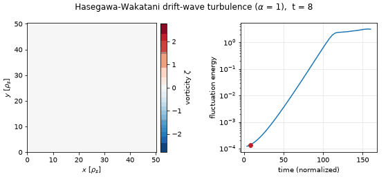

```bash
python examples/tokamak/drift_wave_turbulence.py
```

## Stellarator turbulence on FCI geometry

Four-field interchange turbulence (density, vorticity, and ion and electron
parallel velocity) on a rotating-ellipse stellarator, a torus whose
elliptical cross-section rotates with the toroidal angle. The movie is a
cutaway of density fluctuations on a flux surface and through the interior,
from a 500-step run (t = 1.0, 16x32x16 cells). The fluctuation (about 3% rms)
settles within t = 0.1 and the state stays quasi-steady; at this resolution it
shows low-order band structures rather than fine-scale turbulence. The script
also writes the closed and limiter-terminated open field lines of the same
geometry. About 7 min on a laptop CPU.

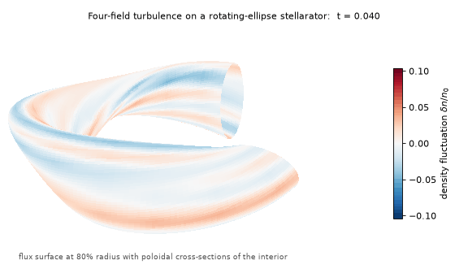

```bash
python examples/stellarator/stellarator_3d_render.py
```

## FCI parallel operators

Parallel derivatives come from field-line tracing and interpolation on a grid
that is not field aligned. On the non-axisymmetric rotating-ellipse metric,
both the direct and the traced-field-line parallel gradients converge at
second order (measured orders 2.02 and 1.99 between 16^3 and 48^3), and the
operator is differentiable with respect to the shape. About 40 s.

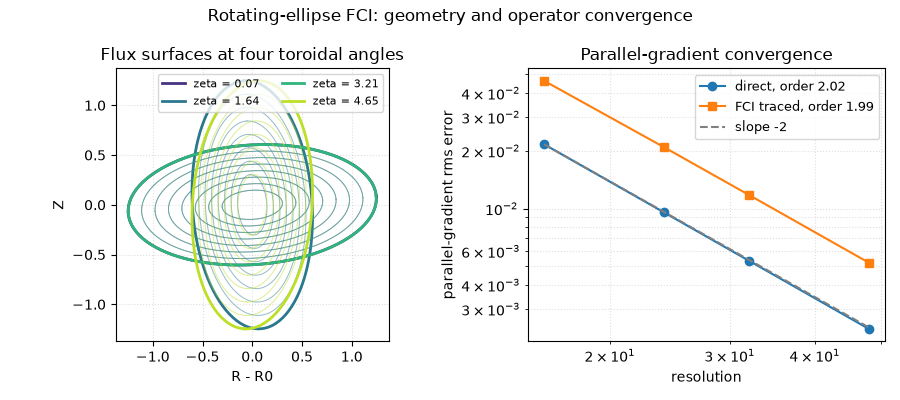

```bash
python examples/stellarator/rotating_ellipse_fci.py
python examples/stellarator/fci_differentiable.py     # shape derivative of the operator
```

## Tilted planes: the FCI approach of the HSX backend

Classic FCI codes put the poloidal planes at fixed toroidal angles and trace
field lines from plane to plane. The HSX backend (`drbx.fci_braginskii`) keeps
the plane-to-plane field-line maps, but its logical planes (the `eta` index of
the geometry bundle) are wall-fitted surfaces: the boundary of every plane is
a vessel contour, and the planes are tilted and curved to follow the twisting
HSX cross-section. In the 32^3 bundle the toroidal angle of the cell centres
varies by about 9 degrees across one plane, almost the 11.25 degrees between
planes (left: three consecutive planes; right: their toroidal angle against
height, with the fixed-angle plane of a classic grid dashed). Parallel
operators use field lines traced from each cell to the neighbouring plane
(mean traced length 0.27 m; about 3% of the forward maps end on the wall).

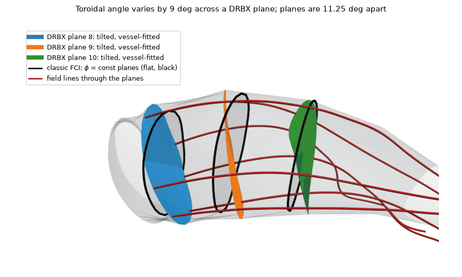

```bash
PYTHONPATH=src python examples/stellarator/hsx_fci_planes.py   # needs the 32^3 bundle and drbx[viz]
```

## Island divertor

A sheared rotational transform with resonant perturbations forms island chains
and a stochastic edge. The open SOL is not imposed: multi-transit field-line
tracing marks the region of finite connection length, and the turbulence drains
through it. The Poincare section uses 120 field lines and 600 transits each.

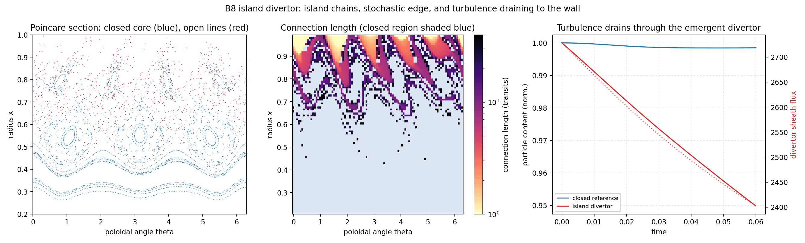

```bash
python examples/stellarator/island_divertor.py
```

## Imported stellarator fields

Field lines run on imported geometry. ESSOS coils give a Biot-Savart field;
traced lines are classified by Poincare crossings as closed (stay on a flux
surface) or open (leave the confined region). The same tracing is available for
VMEC `wout` files through VMEX. The figure shows the traced lines in 3D
and the Poincare section at phi = 0 (30 closed and 30 open lines, 16000 samples each). The 3D view is a PyVista render. Needs `drbx[essos,viz]`; about 3 min.

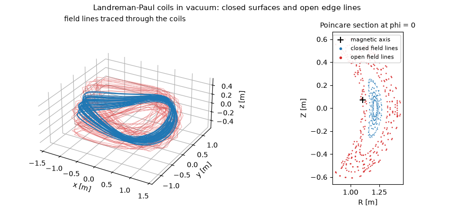

```bash
python examples/geometry-3D/essos-field-lines/closed_open_vacuum_poincare.py
```

Four-field turbulence on the Landreman-Paul precise-QA field
([`landreman_paul_turbulence.py`](examples/stellarator/landreman_paul_turbulence.py))
additionally needs the QA `wout` from an ESSOS checkout:
`DRBX_ESSOS_ROOT=/path/to/ESSOS python examples/stellarator/landreman_paul_turbulence.py`.

## Sheath-bounded SOL, neutrals and detachment

On open field lines, parallel transport to Bohm-sheath targets relaxes to the
two-point steady state (`examples/sol/open_sol_flux_tube.py`: Mach 0.94 at the
targets, target-to-upstream density ratio 0.49; two-point theory gives 1 and
0.5). With fluid neutrals (AMJUEL ionization, recombination and charge
exchange) and recycling, raising the upstream density chokes the target flow:
the Mach number at the target falls through 1 between upstream densities of 4
and 8 in normalized units.

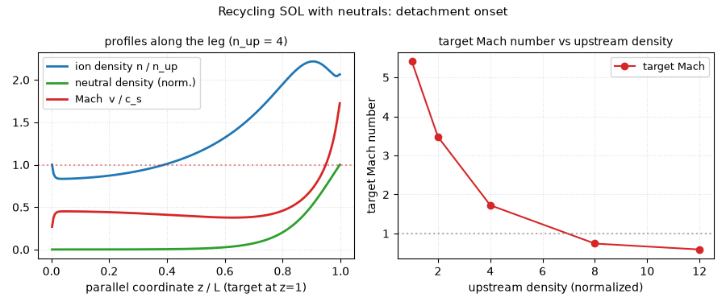

```bash
python examples/sol/recycling_sol.py      # under 10 s
```

The 1D divertor-leg model implements the SD1D equations (Dudson et al.,
*Plasma Phys. Control. Fusion* 61, 065008, 2019) and finds the steady state
with a Newton method. The movie steps through an upstream-density scan; the leg
is drawn with half-width proportional to the square root of the flux-tube area,
on a logarithmic distance-to-target axis, next to the target temperature and
flux against the published SD1D hydrogen-only 13.6 eV scan (800 cells).

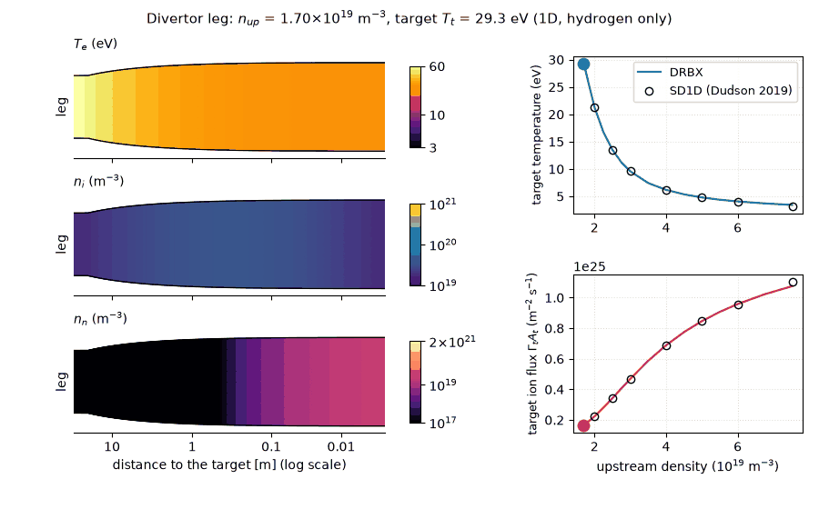

```bash
python examples/benchmarks/b6_detachment_sd1d.py      # about 1 min
```

Analysis: as the upstream density rises from 1.7 to 7.5e19 m^-3 the target
cools from 29 to 3 eV and the neutral density builds up in the last 0.1 m of
the leg, while the target particle flux keeps rising (hydrogen only: no flux
rollover without impurity radiation and excitation, which this model does not
include). Seven of the eight SD1D densities agree to within 0.35% in target
temperature and 0.15% in flux, with particle and power ledgers closed to 1e-9
or better. The eighth SD1D point is not a steady state in its restart data and
differs by about 10%.

## Differentiable design and control

The steady-state solve is differentiated with the implicit-function theorem, so
a controller can use exact sensitivities. Newton steps on `dT_target/dn_upstream`
find the upstream density that gives a 10 eV target temperature in three
updates (200-cell grid, 2.706e19 m^-3, 10.0002 eV; about 2 min):

```bash
python examples/autodiff/detachment_control.py
```

Gradients also pass through nonlinear turbulence. Starting from saturated
Hasegawa-Wakatani turbulence at `alpha = 0.3`, a damped Newton iteration on
`ln(alpha)` (bottom right: the windowed flux objective and `alpha` over the
iterations) finds `alpha = 0.73`, which cuts the windowed flux by 4x. The
figure compares the two long independent runs to t = 250 (top: density at the
end; bottom left: flux traces and their means over the grey window). The
saturated fluxes are 1.00 and 0.31, a 3.2x reduction: the flux fluctuates by
about 25%, so the 4x target is met within the scatter of the short-window
objective. About 3 min.

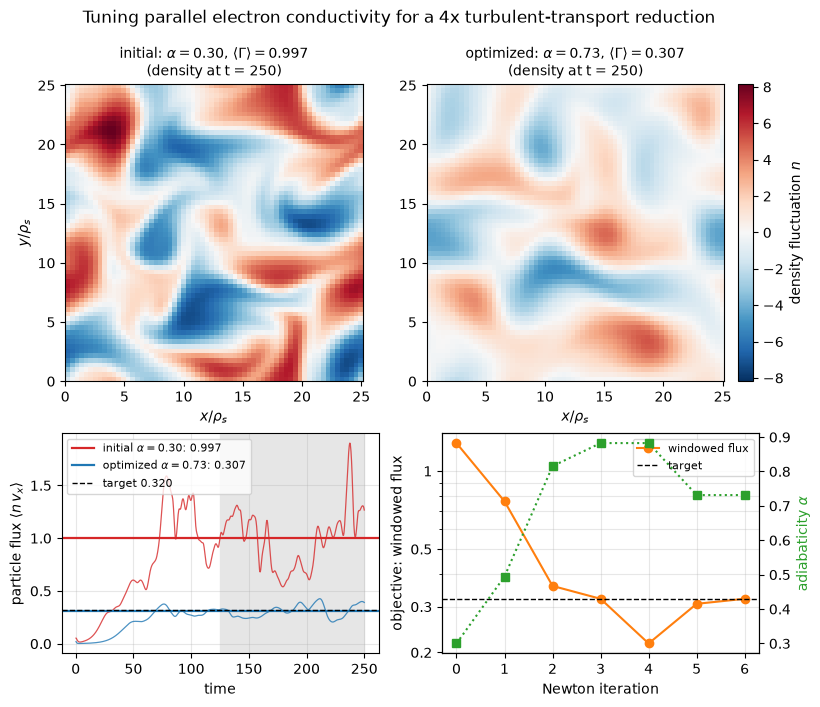

```bash
python examples/tokamak/hasegawa_wakatani_optimization.py
python examples/autodiff/differentiation_methods.py   # forward vs reverse vs checkpointed cost
```

## Verification

`drbx.linear` linearizes a model about an equilibrium. The shear-Alfven
operator reproduces the analytic dispersion relation to 4e-16 (relative), and
the drift-wave operator is scanned in adiabaticity against the analytic
frequency and growth rate. Method-of-manufactured-solutions tests check
second-order convergence of the 1D fluid model and the FCI operators.

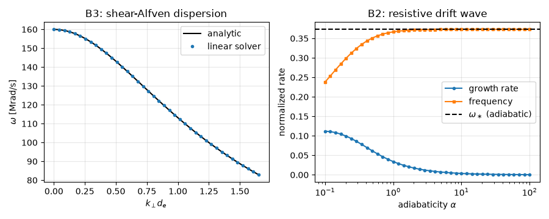

```bash
python examples/benchmarks/linear_dispersion.py
pytest -n 2 -q tests/test_validation_fluid_1d_mms_convergence.py tests/test_mms_convergence.py
```


## Parallel performance

The two-field drift-reduced step runs across devices with `shard_map`, and every
device count gives the same result (checksums agree to 1e-10;
[`tests/test_fci_sharded_2field.py`](tests/test_fci_sharded_2field.py)). The
figure uses 512x256x32 cells (4.2 M) and 10 timed RK4 steps per device count,
with CPU devices pinned one core each on a 36-core Linux host that was shared
and heavily loaded (load average about 25): 8.0 s per step on one device and
2.0 s on 16 (4.0x, throughput 0.5 to 2.1 Mcell/s). An earlier run of the same script on a
256x128x32 grid (1.05 M cells) gave 6.2x at 16 shards. On a laptop one XLA device already
threads across all cores, so sharding gains little there. One NVIDIA A4000 ran
a 1.05M-cell step about 21x faster than a single CPU shard (measured by hand,
not reproduced by the script). The FCI operator and domain-decomposition stack
was contributed by Aiken Xie in [PR #3](https://github.com/uwplasma/drbx/pull/3).

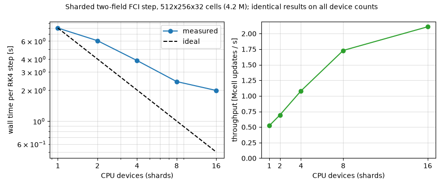

```bash
python examples/benchmarks/fci_sharded_strong_scaling.py
```

## HSX geometry and scrape-off-layer filament

The HSX geometry is built from the coils in
[`examples/inputs/hsx/coils.hsx`](examples/inputs/hsx/coils.hsx) (QHS currents)
and the vessel outline [`vessel_hsx_flare.txt`](examples/inputs/hsx/vessel_hsx_flare.txt).
The figure shows the coils (PyVista render), the boundary of the simulated
domain colored by |B| and the vessel; a Poincare section at phi = 0 traced
through the coil field (90 lines, about 320 toroidal turns each; blue points
stay inside the vessel, red diamonds mark lines that reach the wall); and the
connection length to the wall on the same plane.

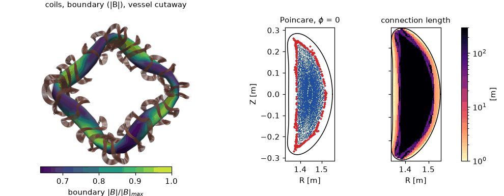

The `drbx.fci_braginskii` backend evolves a density filament in the
scrape-off layer up to the vessel wall. It has a Bohm sheath wall closure by
default, with optional neutrals and recycling (deck keys `wall_closure`,
`neutrals`, `recycling`; see [docs/decks.md](docs/decks.md)). The first run is
`drbx run examples/inputs/hsx_fci_blob.toml`, which builds a 16^3 geometry from
the shipped coils and vessel (about 4 min on a laptop). The movie is a 32^3 run
(600 steps, t = 0.45 in L_ref/c_s, peak n - 1 = 0.8, rho* = 5e-3, zero-flow walls;
about 35 min on one A4000): isosurfaces of the density perturbation along the
field over the boundary surface, with R-Z sections of density and potential
through the filament. The potential builds up as a dipole around the filament
within the first t = 0.05. The filament itself stays close to its flux surface
in this time: its density-weighted radial index moves from 16.9 to 16.5 of 32
cells while the peak decays from 0.75 to 0.48. The geometry bundle is described
in [docs/fci_braginskii_hsx_backend.md](docs/fci_braginskii_hsx_backend.md).

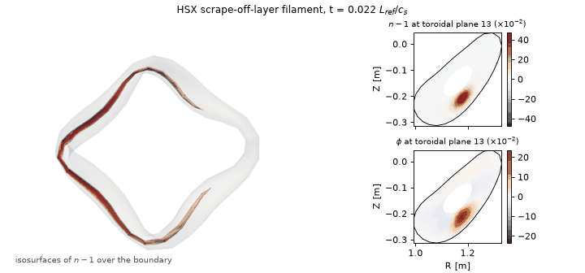

```bash
python examples/stellarator/hsx_fci_blob_render.py   # runs the backend, then renders both figures (drbx[viz])
```

## Tests

```bash
pip install -e ".[dev]"   # or: pip install pytest pytest-xdist
pytest -n 2 -q -m "not slow"
```

CI runs the fast suite on Python 3.10-3.12 (CPU). Policy:
[docs/testing_strategy.md](docs/testing_strategy.md).

## More

[Equation-to-code map](docs/equation_to_code_map.md),
[physics models](docs/physics_models.md),
[validation gallery](docs/validation_gallery.md) (with the comparison against
other edge codes), [island-tokamak write-up](docs/island_tokamak.md) and
[release notes](docs/release_notes.md).

## Citing and license

If you use DRBX in published work, please cite https://github.com/uwplasma/DRBX.
MIT license, see [LICENSE](LICENSE).
