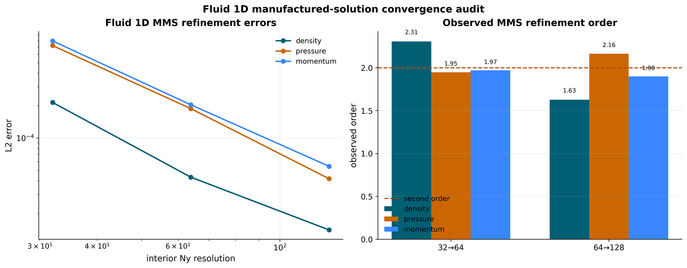

# DRBX

[](https://github.com/uwplasma/drbx/actions/workflows/test.yml)
[](https://github.com/uwplasma/drbx/actions/workflows/docs.yml)
[](https://pypi.org/project/drbx/)
[](LICENSE)

DRBX is a JAX code for drift-reduced Braginskii fluid simulations of edge and
scrape-off-layer (SOL) plasma turbulence. Parallel operators use the
flux-coordinate-independent (FCI) approach, so the same models run on closed
and open field lines in tokamak and non-axisymmetric stellarator geometry.
Every solver is written in JAX: steps are `jit`-compiled, and outputs can be
differentiated with respect to physical and geometric inputs.

- **Models:** Hasegawa-Wakatani, two- and four-field drift-reduced turbulence, electromagnetic terms, fluid neutrals with AMJUEL rates, a 1D divertor-leg model.
- **Geometry:** rotating-ellipse and shifted-torus stellarators, island divertors, and imported ESSOS coil fields and VMEC (VMEX) equilibria.
- **Gradients:** forward, reverse and checkpointed reverse mode, used for sensitivity, inverse design and control.
- **Runtime:** TOML-deck CLI, small Python API, restartable runs, multi-device `shard_map` stepping.

Documentation: [drbx.readthedocs.io](https://drbx.readthedocs.io/en/latest/).
Every section below names the script that produces its figure; run it from the
repository root.

## Install

```bash
pip install drbx
# or, from source:
git clone https://github.com/uwplasma/drbx && cd drbx && pip install -e .
```

Python 3.10 or newer. CPU JAX is installed by default; for a GPU, install the
matching JAX wheel following the
[JAX guide](https://docs.jax.dev/en/latest/installation.html). ESSOS coil
imports need `pip install "drbx[essos]"`.

## Quick start

```bash
drbx inspect examples/inputs/restartable_diffusion.toml   # print the resolved plan
drbx run     examples/inputs/restartable_diffusion.toml   # run and write artifacts
```

From Python, a Hasegawa-Wakatani run is one function call, and its gradient
with respect to a physical parameter is one more:

```python
import jax, jax.numpy as jnp, numpy as np
from drbx.native.hasegawa_wakatani import HasegawaWakataniParameters, hw_grid, hw_run

grid = hw_grid(64, 2 * jnp.pi * 8)
rng = np.random.default_rng(0)
zeta0 = jnp.fft.fft2(jnp.asarray(1e-2 * rng.standard_normal((64, 64))))
n0 = jnp.fft.fft2(jnp.asarray(1e-2 * rng.standard_normal((64, 64))))

def density_energy(alpha):
    params = HasegawaWakataniParameters(adiabaticity=alpha, gradient=1.0)
    _, n = hw_run(zeta0, n0, grid, params, dt=5e-3, steps=200)
    return jnp.sum(jnp.abs(n) ** 2).real

print(jax.grad(density_energy)(1.0))   # d(energy)/d(adiabaticity) through 200 steps
```

Examples are flat scripts: parameters at the top, then run and plot, writing
to `output/`. [`examples/model_selection_guide.py`](examples/model_selection_guide.py)
helps choose a model family, dimension and boundary conditions.

## Drift-wave turbulence

The Hasegawa-Wakatani model on a doubly periodic plane: density-gradient-driven
drift waves saturate into turbulence with zonal flows. The adiabaticity
`alpha` sets the regime, from streamer-like transport at small `alpha` to
wave-like transport at large `alpha`. The default run (96x96 modes, t = 160) takes about 80 s on a laptop CPU.


```bash
python examples/tokamak/drift_wave_turbulence.py
```

## Stellarator turbulence on FCI geometry

Four-field interchange turbulence (density, vorticity, and ion and electron
parallel velocity) on a rotating-ellipse stellarator, a torus whose
elliptical cross-section rotates with the toroidal angle. The movie is a
cutaway of density fluctuations on a flux surface and through the interior.
The script also writes the closed (blue) and limiter-terminated open (red)
field lines of the same geometry. About 3 min on a laptop CPU.


```bash
python examples/stellarator/stellarator_3d_render.py
```

## FCI parallel operators

Parallel derivatives come from field-line tracing and interpolation on a grid
that is not field aligned. On the non-axisymmetric rotating-ellipse metric,
both the direct and the traced-field-line parallel gradients converge at
second order (measured orders 2.02 and 1.99 between 16^3 and 48^3), and the
operator is differentiable with respect to the shape. About 40 s.


```bash
python examples/stellarator/rotating_ellipse_fci.py
python examples/stellarator/fci_differentiable.py     # shape derivative of the operator
```

## Island divertor

A sheared rotational transform with resonant perturbations forms island chains
and a stochastic edge. The open SOL is not imposed: multi-transit field-line
tracing marks the region of finite connection length, and the turbulence drains
through it. About 4 min.


```bash
python examples/stellarator/island_divertor.py
```

## Imported stellarator fields

Field lines run on imported geometry. ESSOS coils give a Biot-Savart field;
traced lines are classified by Poincare crossings as closed (stay on a flux
surface) or open (leave the confined region). The same tracing is available for
VMEC `wout` files through VMEX. The figure shows the traced lines in 3D
and the Poincare section at phi = 0. Needs `drbx[essos]`; runs in about 10 s.


```bash
python examples/geometry-3D/essos-field-lines/closed_open_vacuum_poincare.py
```

Four-field turbulence on the Landreman-Paul precise-QA field
([`landreman_paul_turbulence.py`](examples/stellarator/landreman_paul_turbulence.py))
additionally needs the QA `wout` from an ESSOS checkout:
`DRBX_ESSOS_ROOT=/path/to/ESSOS python examples/stellarator/landreman_paul_turbulence.py`.

## Sheath-bounded SOL, neutrals and detachment

On open field lines, parallel transport to Bohm-sheath targets relaxes to the
two-point steady state (`examples/sol/open_sol_flux_tube.py`: Mach 0.94 at the
targets, target-to-upstream density ratio 0.49; two-point theory: 1 and 0.5).
With fluid neutrals (AMJUEL ionization, recombination and charge exchange) and
recycling, raising the upstream density cools the target and chokes its flow
through charge-exchange friction, the onset of detachment
(`examples/sol/recycling_sol.py`, under 10 s each).

The 1D divertor-leg model implements the SD1D equations (Dudson et al., *Plasma
Phys. Control. Fusion* 61, 065008, 2019) and finds the steady state with a
Newton method. The movie steps through the upstream-density scan: the leg
(drawn with half-width proportional to the square root of the flux-tube area,
on a logarithmic distance-to-target axis) colored by electron temperature, ion
density and neutral density, next to the target temperature and particle flux
against the published SD1D hydrogen-only 13.6 eV scan (800 cells). Seven of the
eight SD1D densities agree to within 0.35% in target temperature and 0.15% in
target particle flux, with particle and power ledgers closed to 1e-9 or
better. The eighth reference point is not a steady state in the SD1D restart
data and differs by about 10%. Carbon radiation is not modelled. About 1 min.


```bash
python examples/benchmarks/b6_detachment_sd1d.py
```

## Differentiable design and control

The steady-state solve is differentiated with the implicit-function theorem, so
a controller can use exact sensitivities. Newton steps on `dT_target/dn_upstream`
find the upstream density that gives a 10 eV target temperature in three
updates (200-cell grid, 2.706e19 m^-3, 10.0002 eV; about 2 min):

```bash
python examples/autodiff/detachment_control.py
```

Gradients also pass through nonlinear turbulence. Starting from saturated
Hasegawa-Wakatani turbulence at `alpha = 0.3`, a damped Newton iteration on
`ln(alpha)` finds the adiabaticity that cuts the saturated particle flux by 4x
(achieved 3.96x at `alpha = 0.73`, checked by independent long runs). About
2.5 min.


```bash
python examples/tokamak/hasegawa_wakatani_optimization.py
python examples/autodiff/differentiation_methods.py   # forward vs reverse vs checkpointed cost
```

## Verification

`drbx.linear` linearizes a model about an equilibrium. The shear-Alfven
operator reproduces the analytic dispersion relation to 4e-16 (relative), and
the drift-wave operator is scanned in adiabaticity against the analytic
frequency and growth rate. Method-of-manufactured-solutions tests check
second-order convergence of the 1D fluid model and the FCI operators.


```bash
python examples/benchmarks/linear_dispersion.py
pytest -n 2 -q tests/test_validation_fluid_1d_mms_convergence.py tests/test_mms_convergence.py
```

<table><tr>
<td></td>
<td></td>
</tr></table>

## Parallel performance

The two-field drift-reduced step runs across devices with `shard_map` and is
bit-exact against the single-device step
([`tests/test_fci_sharded_2field.py`](tests/test_fci_sharded_2field.py)). On a
36-core Linux host, a 1.05M-cell step speeds up 4.5x at 16 shards (1.18 s to
0.27 s); one NVIDIA A4000 runs the same step about 21x faster than a single CPU
shard with identical checksums. GPU numbers were measured by hand; CI is CPU
only. The FCI operator and domain-decomposition stack was contributed by Aiken
Xie in [PR #3](https://github.com/uwplasma/drbx/pull/3).


```bash
python examples/benchmarks/fci_sharded_strong_scaling.py
```

## HSX geometry and scrape-off-layer filament (experimental)

The HSX geometry is built from the coils shipped in
[`examples/inputs/hsx/coils.hsx`](examples/inputs/hsx/coils.hsx) (QHS currents)
and the vessel outline. The first figure shows the coils, the boundary of the
simulated domain colored by |B| and the vessel; a Poincare section at phi = 0
(field lines traced through the coil field; blue lines stay inside the vessel
for the whole trace, red reach the wall); and the connection length to the wall
on the same plane.


An experimental electrostatic Braginskii backend (`drbx run
examples/inputs/hsx_fci_blob.toml`) then evolves a seeded filament in the
scrape-off layer up to the vessel wall on a 32^3 field-aligned grid (200 steps,
t = 0.15 in L_ref/c_s, about 20-30 min on a laptop CPU). Left: cells with large
density perturbation in 3D; right: R-Z sections of density and potential
through the filament. The model has no sheath, neutral or recycling coupling
yet and needs a geometry bundle built with
[`generate_hsx_fci_geometry.py`](generate_hsx_fci_geometry.py); see
[docs/fci_braginskii_hsx_backend.md](docs/fci_braginskii_hsx_backend.md).


```bash
python examples/stellarator/hsx_fci_blob_render.py   # runs the backend, then renders both figures
```

## Tests

```bash
pip install -e ".[dev]"   # or: pip install pytest pytest-xdist
pytest -n 2 -q -m "not slow"
```

CI runs the fast suite on Python 3.10-3.12 (CPU). Policy:
[docs/testing_strategy.md](docs/testing_strategy.md).

## More

[Equation-to-code map](docs/equation_to_code_map.md),
[physics models](docs/physics_models.md),
[validation gallery](docs/validation_gallery.md) (with the comparison against
other edge codes), [island-tokamak write-up](docs/island_tokamak.md) and
[release notes](docs/release_notes.md).

## Citing and license

If you use DRBX in published work, please cite https://github.com/uwplasma/DRBX.
MIT license, see [LICENSE](LICENSE).
