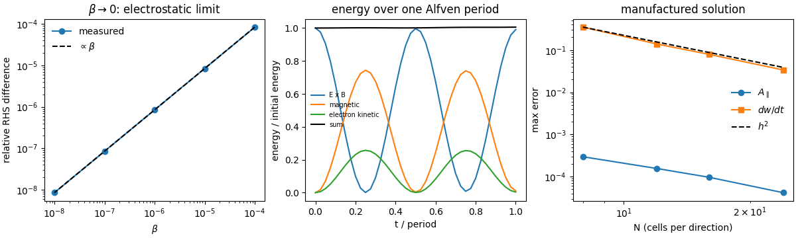
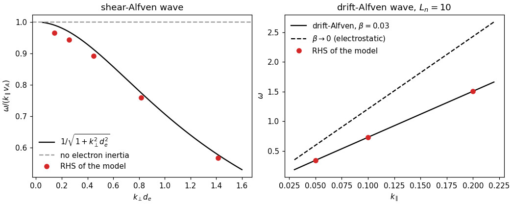
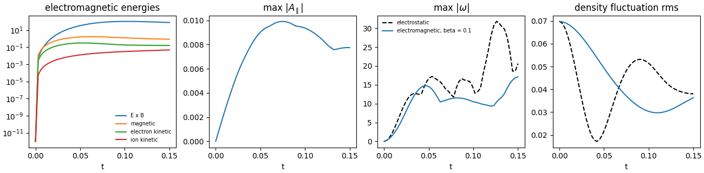
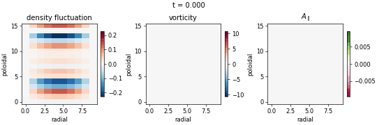

# Electromagnetic Model

DRBX evolves the parallel vector potential A_par in the four-field FCI model
(deck backend `stellarator_turbulence`). One deck switch adds Ampere's law,
magnetic flutter of every parallel gradient and electron inertia:

```toml
[physics]
electromagnetic = true
beta = 0.1            # mu0 n T / B^2
mi_over_me = 1836.0
```

`drbx run examples/inputs/electromagnetic_turbulence.toml` runs it. With
`electromagnetic = false` (the default) the electrostatic code path is the same
code as before and gives bitwise identical results. The model is differentiable
in forward mode (`jax.jvp`) through the whole RK4 step; reverse mode is not
available through the GMRES potential solve in either model.

## Equations

The evolved `v_electron_parallel` is the canonical electron momentum

```text
w = v_e - (mi/me) A_par
```

Each right-hand-side evaluation solves Ampere's law for A_par,

```text
(-lap_perp + beta (mi/me) n) A_par = beta n (v_i - w),      v_e = w + (mi/me) A_par
```

and adds the flutter term to the parallel gradients of the density, the
potential and both parallel velocities,

```text
grad_par f  ->  grad_par f + {A_par, f} / (rho_star B)
```

so the electron parallel force balance is
`dw/dt = -{phi, v_e}/(rho_star B) + (mi/me) (grad_par phi - Te grad_par n / n)`
and the vorticity equation carries the flutter current divergence
`(B^2/n) grad_par (v_i - v_e)`. The fixed-coefficient Helmholtz operator
`-lap_perp + beta (mi/me) n_ref` is the potential solver with
`regularization_epsilon`; the density variation about `n_ref`
(`reference_density`) is iterated `ampere_iterations` times (one pass is exact
for uniform density).

The linear waves are

```text
omega = k_par v_A / sqrt(1 + k_perp^2 d_e^2),    v_A^2 = B^2 / (beta n),    d_e^2 = 1 / (beta (mi/me) n)
```

for the shear-Alfven wave, and in a density gradient (`omega_* = k_y / L_n`) the
drift-Alfven wave, for which the flutter of the background gradient
`b1.grad n0` (the term `omega_* A_par` in the pressure-gradient force) couples
the Alfven and drift-sound branches.

## Verification

`tests/test_electromagnetic_fci.py` seeds waves of the production RK4 step in a
slab with the eigenvector of the 4x4 local dispersion matrix for
`(phi, n1/n0, v_i, w)` (`drbx.validation.electromagnetic_waves`) and reads the
phase of phi.

| check | measured | analytic | difference |
| --- | --- | --- | --- |
| shear-Alfven, beta 0.5 (k_perp d_e 0.14), 12x3x16 cells | 0.3412 | 0.3501 | -2.5% |
| shear-Alfven, beta 0.005 (k_perp d_e 1.4), 12x3x16 | 2.006 | 2.041 | -1.7% |
| drift-Alfven, L_n 10, beta 0.03, k_par 0.1, 12x16x16 | 0.7310 | 0.7292 | +0.24% |
| electrostatic limit of the same drift-Alfven case | | 1.206 | resolved: 40% lower with A_par |
| beta -> 0: max RHS difference to electrostatic / max RHS | 8.5e-7 (beta 1e-6), 8.5e-9 (1e-8) | linear in beta | |
| energy ExB + magnetic + electron kinetic over one period | drift 0.55% (amplitude 1e-3), 2.7% (0.05) | conserved | ExB and magnetic swing 100% and 74% |
| manufactured solution, N = 8, 16, 24 | A: 3.0e-4, 9.6e-5, 4.2e-5; dw/dt: 0.349, 0.079, 0.034 | order 2 | observed 2.1 |

Each row is anchored as follows. The shear-Alfven dispersion with electron
inertia follows Stegmeir et al., Phys. Plasmas 26, 052517 (2019), and the
Alfven-wave tests of Dudson et al., Comput. Phys. Commun. 180, 1467 (2009). The
drift-Alfven wave, including the flutter of the background gradient, follows
Scott, Phys. Plasmas 10, 963 (2003). The beta -> 0 limit, the energy balance and
the manufactured solution are properties of the equations and the discretization
rather than of a paper: A_par and the flutter are O(beta), the sum of the E x B,
magnetic (`<A j_par>/2`) and electron kinetic energies is the quadratic
invariant of the cold model, and the manufactured source is built from the
analytic fields with `jax.grad`.



`examples/electromagnetic/electromagnetic_verification.py` writes the figure:
the relative right-hand-side difference to the electrostatic model against beta
(slope 1, 8.5e-9 at beta = 1e-8), the energies over one period (sum drifts by
0.55%) and the error of A_par and dw/dt against grid size (dw/dt converges at
order 2.1; the A_par error is 3.0e-4, 1.6e-4, 9.6e-5, 4.2e-5 at N = 8, 12, 16, 24).



`examples/electromagnetic/alfven_dispersion.py` writes the figure: the shear-Alfven
frequency against `1/sqrt(1 + k_perp^2 d_e^2)` and the drift-Alfven frequency
against its electrostatic limit.

## Turbulence example

`examples/electromagnetic/electromagnetic_turbulence.py` runs the deck larger
with and without A_par and plots the energies (E x B, magnetic, electron and
ion kinetic), max A_par, max vorticity and the density fluctuation spread, and
a short movie of the density, vorticity and A_par in one toroidal plane.





Electromagnetic runs write `apar_frames` and `energies` beside the usual
arrays, and `final_energy_components` in the summary.

## Cost

`examples/electromagnetic/step_time.py` times one jitted RK4 step.

| device | grid (cells) | electrostatic, ms/step | electromagnetic, ms/step | ratio |
| --- | --- | --- | --- | --- |
| laptop CPU | 8x12x6 | 5.2 (min of 16) | 13.7 | 2.6 |
| laptop CPU | 16x24x12 | 74.3 | 198.2 | 2.7 |
| NVIDIA RTX A4000 (one, shared host) | 8x12x6 | 112.6 | 260.5 | 2.3 |
| NVIDIA RTX A4000 | 16x24x12 | 204.8 | 509.7 | 2.5 |

Minimum of 16 jitted steps after warm-up (medians are 6.3, 101, 154 and 258 ms for
the electrostatic steps and 19.7, 227, 318 and 591 ms for the electromagnetic
ones; the hosts were shared). The closure adds two Helmholtz GMRES solves
(`ampere_iterations = 2`) and four bracket evaluations per right-hand side, so a
step costs about 2.5 times the electrostatic one. These grids are
latency-bound on the GPU, which is slower than the CPU at this size; the closure
does not change that.

Options for the overhead, 16x24x12 CPU grid, minimum of 10 steps, two interleaved
passes (A/B/A/B) on a shared host; temporary buffers of the compiled step are
14 MB (electrostatic) and 16 MB (electromagnetic):

| configuration | ms/step, pass 1 and 2 |
| --- | --- |
| electrostatic | 87, 99 |
| electromagnetic, `ampere_iterations = 2`, `ampere_tol = 1e-8` (default) | 197, 163 |
| `ampere_iterations = 1` | 148, 121 |
| `ampere_iterations = 1`, `ampere_tol = 1e-5` | 118, 117 |
| `ampere_iterations = 2`, `ampere_tol = 1e-5` | 182, 117 |

One iteration is exact for uniform density; with density variation about
`reference_density` it leaves the defect uncorrected. The timings vary by
about 30% between passes, so the ordering of the last two rows is not resolved.
Sharing the potential-solve preconditioner, solving once per stage, fusing the
flutter brackets and warm-starting A from the previous step are not implemented.

## Limits

Reverse-mode gradients through the step require the implicit-function VJP of the Krylov solves (see the gradient PR). The `fci_braginskii` HSX backend, the 1D SOL flux tube and the 2D
Hasegawa-Wakatani box do not carry A_par: the HSX electron equation has the same
`(mi/me) grad_par phi` form and takes the same closure, the flux tube has no
perpendicular structure to invert and the HW box has no parallel direction. The
perpendicular Laplacian of the potential solver has a wide stencil with an O(1)
inconsistency at the periodic seam cells in y, so the verification slabs put the
perpendicular structure in x with Dirichlet walls.
