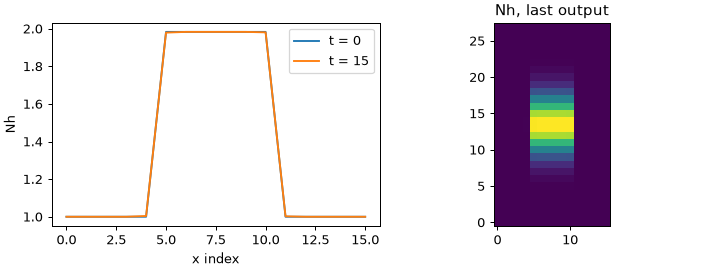
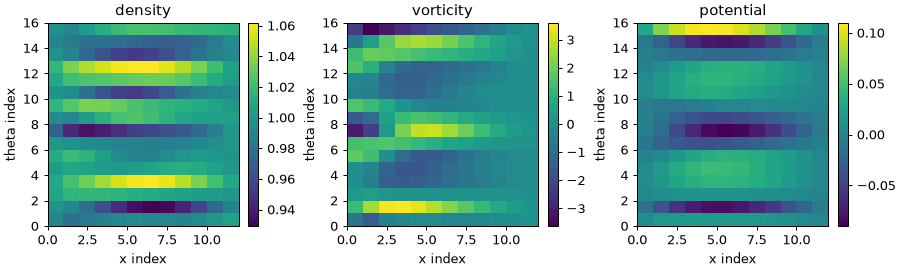
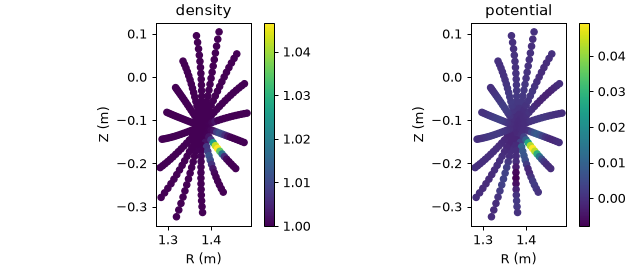

# Tutorial

A short path from installation to a stellarator run and a gradient. Every
command below was run on a laptop CPU from the repository root. Models run in
float64.

## 1. Install

```bash
git clone https://github.com/uwplasma/DRBX && cd DRBX
pip install -e .
drbx --help
```

See [Installation](installation.md) for the PyPI package and the docs extra.

## 2. First run

`drbx` runs TOML input decks. The smallest one evolves a density and a
pressure under radial diffusion (about 2 s):

```bash
drbx inspect examples/inputs/restartable_diffusion.toml
drbx run examples/inputs/restartable_diffusion.toml
```

`inspect` prints the resolved mesh, time step and scheduled components without
running. `run` writes four files to `output/restartable_diffusion/`:
`*_summary.json` (min, max, mean of each variable), `*_arrays.npz` (every
output time), `*_restart.npz` (resume point) and `*_run_log.json`. Continue a
run with `--restart-in <restart.npz> --resume-steps N`; all deck keys and flags
are in [Native Runtime CLI](native_runtime_cli.md).

## 3. Read the outputs

The arrays file loads with `load_portable_array_payload`: `variables["Nh"]` has
shape `(time, x, y, z)` including guard cells, `time_points` holds the output
times.

```python
import matplotlib.pyplot as plt
from drbx.native.deck_runner import load_portable_array_payload

run = load_portable_array_payload("output/restartable_diffusion/restartable_diffusion_arrays.npz")
nh, t = run["variables"]["Nh"], run["time_points"]
fig, (a, b) = plt.subplots(1, 2, figsize=(8, 3), layout="constrained")
for k in (0, -1):
    a.plot(nh[k, :, nh.shape[2] // 2, 0], label=f"t = {t[k]:g}")
a.set(xlabel="x index", ylabel="Nh"); a.legend()
b.imshow(nh[-1, :, :, 0].T, origin="lower"); b.set(title="Nh, last output")
fig.savefig("nh.png", dpi=90)
```



The initial top hat in x smooths at its edges; the deck diffuses radially only,
so the y shape is unchanged.

## 4. Four-field drift-reduced model in a tokamak

The four-field model evolves density, vorticity and the ion and electron
parallel velocities, and solves the polarization equation for the potential at
every step ([equations](models_and_equations.md)). It runs on a flux-coordinate
independent (FCI) grid, where the parallel derivative follows traced field
lines. A rotating-ellipse geometry with `elongation = 0` is a circular torus,
that is a tokamak flux tube; `elongation > 0` makes it a stellarator.

```bash
PYTHONPATH=src python examples/tutorial_four_field.py   # about 15 s
```

It builds the geometry, seeds a multi-mode density perturbation, takes 100 RK4
steps, prints the maximum vorticity every 20 steps and plots the density,
vorticity and potential on one toroidal plane. Edit the `PARAMETERS` block
(`ELONGATION`, `SHAPE`, `STEPS`) and rerun.



The potential is obtained from the vorticity by the polarization solve. Closed versus limiter-open field lines, with a sheath sink, are covered in
[Stellarator FCI Turbulence](tutorial_stellarator_fci.md).

## 5. Stellarator FCI: HSX from coils

`drbx.fci_braginskii` is the production seven-field backend. It runs on a
precomputed HSX geometry bundle built from the coil file shipped in the
repository, `examples/inputs/hsx/coils.hsx`, and the HSX vessel outline
`examples/inputs/hsx/vessel_hsx_flare.txt`; both are used by default, so it
builds from a fresh clone.

A small bundle (16 cells per direction, about 3 min):

```bash
python generate_hsx_fci_geometry.py --resolution 16 16 16 --metric-mesh-shape 16 16 16 \
  --metric-poloidal-modes 6 --metric-toroidal-modes 3 --toroidal-modes 3 \
  --output output/hsx_16
```

Seed a density filament and advance four IMEX steps (about 90 s, mostly
one-time compilation):

```bash
python simulate_hsx_blob.py --geometry output/hsx_16 --num-steps 4 --final-time 3e-3 \
  --save-every 4 --output output/hsx/history.npz
```

Each progress line gives the step time, the GMRES iterations of the implicit
potential solve and the density range. `history.npz` holds `density`, `phi`,
`Te`, `Ti`, `Ve`, `Vi`, `vorticity` per saved time and the grid positions
(`cartesian`, `times`).

```python
import matplotlib.pyplot as plt
import numpy as np

h = np.load("output/hsx/history.npz")
n, phi, xyz = h["density"], h["phi"], h["cartesian"]   # n[time, u, v, eta]; xyz[u, v, eta, 3]
k = int(np.argmax((n[0] - 1).max(axis=(0, 1))))        # toroidal plane through the filament
R, Z = np.hypot(xyz[:, :, k, 0], xyz[:, :, k, 1]), xyz[:, :, k, 2]
fig, axes = plt.subplots(1, 2, figsize=(7, 3), layout="constrained")
for ax, f, title in zip(axes, (n[-1, :, :, k], phi[-1, :, :, k]), ("density", "potential")):
    m = ax.scatter(R, Z, c=f, s=25); fig.colorbar(m, ax=ax)
    ax.set(title=title, xlabel="R (m)", ylabel="Z (m)", aspect="equal")
fig.savefig("hsx.png", dpi=90)
```



Points are cell centres on the plane through the filament. The potential peaks
on the filament and the density starts to move. The documented 32-cell bundle,
longer runs, normalization and restarts are on the
[backend page](fci_braginskii_hsx_backend.md); the `drbx run` form is
`examples/inputs/hsx_fci_blob.toml`.

## 6. Differentiability

The models are written in JAX, so a scalar of a run can be differentiated with
respect to its inputs. This example differentiates a mismatch between a
diffusion run and a synthetic target with respect to four parameters (the
diffusivity and the shape of the initial blob) and checks it against central
finite differences (about 35 s):

```bash
PYTHONPATH=src python examples/autodiff_diffusion_sensitivity.py
```

The printed autodiff and finite-difference gradients agree to about five
digits. A plot and a JSON file are written under `docs/data/`, which git
ignores. Forward, reverse and checkpointed modes are compared in
[Performance And Differentiability](performance_and_differentiability.md).

## 7. Where to go next

- Equations and their code: [Models And Equations](models_and_equations.md),
  [Equation To Code Map](equation_to_code_map.md).
- Drift-wave turbulence from noise: [Turbulence From Zero](tutorial_hasegawa_wakatani.md).
- Open field lines, sheaths, neutrals: [Open SOL, Neutrals, Detachment](tutorial_open_sol.md).
- Every example script: [Examples And Artifacts](examples.md).
- What is verified and how: [Testing Strategy](testing_strategy.md).
