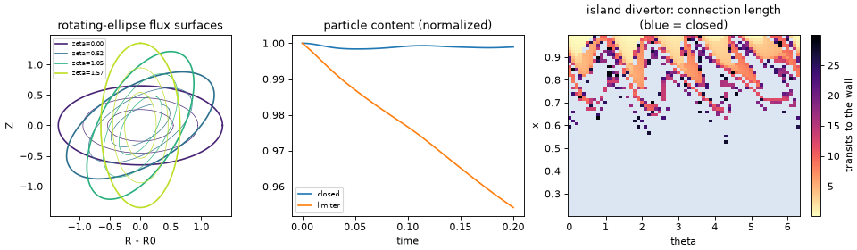

# 06 Geometries: a stellarator, a limiter SOL, an island divertor

**Goal:** move from slabs to 3-D magnetic geometry. Build a rotating-ellipse
stellarator with flux-coordinate-independent (FCI) maps, run the same
turbulence model with all field lines closed and with a limiter that opens
the edge, then map where the field lines of an island divertor end.

Script: [`examples/tutorial/06_geometries.py`](../../examples/tutorial/06_geometries.py)

## FCI geometry in one paragraph

Each toroidal plane \(\zeta_k\) has its own \((x, \theta)\) grid. The
parallel derivative is not taken along a coordinate: field lines are traced
from every cell centre to the next and previous planes, and
\(\nabla_\parallel f \approx [f(\text{forward point}) - f(\text{backward point})]/(2\,\Delta s)\)
interpolates \(f\) at the traced points. The metric (Jacobian \(J\), the
perpendicular metric, curvature) comes from automatic differentiation of the
embedding \((x, \theta, \zeta) \mapsto (X, Y, Z)\). A field line that leaves
the domain before reaching the next plane has an *open endpoint*; the cells
that own such endpoints touch a wall.

## Part 1-2: the 4-field interchange model

Density \(n\), vorticity \(\omega\), and the ion and electron parallel
velocities (the full set is in
[Models and Governing Equations](../models_and_equations.md#fci-4-field-interchange-model)):

$$
\partial_t n = -\frac{\{\phi, n\}}{\rho_\star B} + \frac{2T_e}{B}C(n) - \frac{2n}{B}C(\phi) - n\nabla_\parallel V_{\parallel e},
\qquad -\nabla_\perp^2\phi = -\omega .
$$

The curvature operator \(C\) drives interchange turbulence from the density
seed. With the limiter (`LIMITER_RADIUS = 0.6`: field lines with
\(x > 0.6\) end on a limiter at \(\zeta = 0\)), the endpoint cells also lose
particles at the Bohm rate \(n c_s\), as in step 04.

| Piece | Code |
|---|---|
| rotating-ellipse embedding, FCI maps, metric | `drbx.geometry.build_rotating_ellipse_geometry` (`limiter_radius=` opens the edge) |
| curvature coefficients \(C\) | `drbx.geometry.build_curvature_coefficients` |
| RK4 step with the GMRES potential inversion | `drbx.native.stellarator_turbulence`: `four_field_rk4_step`, `build_four_field_phi_solver` |
| Bohm sheath sink on open endpoints | `apply_sheath_sink` |
| seed | `multi_mode_state` |

## Part 3: the island divertor

`IslandDivertorField` is an analytic field with a closed core, an island
chain and a stochastic edge. `island_divertor_connection_length` traces
field lines from a grid of \((x, \theta)\) starting points and counts toroidal
transits until each hits the wall (or `MAX_TRANSITS` is reached: closed).
Nothing about the topology is imposed; it comes out of the tracing.

## Run

```bash
PYTHONPATH=src python examples/tutorial/06_geometries.py
```

Python only (about 13 s; the first step of each run includes compilation).

## Output

```text
[06] limiter geometry: 192 open field-line endpoints (closed geometry: 0)
[06]   closed step=100 t=0.200 max|Omega|=9.579e+00 sheath loss=0.000e+00 (4.9s)
[06]   limiter step=100 t=0.200 max|Omega|=1.121e+01 sheath loss=2.342e+02 (4.9s)
[06] closed: particle content 1.0000 -> 0.998956
[06] limiter: particle content 1.0000 -> 0.954127
[06] island divertor: open fraction 0.00 in the core (x<0.5), 0.85 at the edge (x>0.9)
```



- **Left:** the cross-section is an ellipse that rotates with \(\zeta\): a
  one-period stellarator.
- **Middle:** closed field lines keep their particles (the 0.1% change comes
  from the free-decay radial walls). With the limiter, the same turbulence
  drains about 5% of the particles through the sheath in \(t = 0.2\).
- **Right:** field lines from the core never reach the wall (blue); 85% of
  the edge field lines do, after a number of transits that varies strongly
  from line to line: the signature of a stochastic layer.

Fields imported from ESSOS coils or VMEX/VMEC equilibria use the same FCI
machinery; they need those optional packages, so this tutorial only points to
them: [ESSOS Field-Line Import](../essos_fieldline_import.md),
[Stellarator Examples](../stellarator_examples.md).

## Try next

- Set `LIMITER_RADIUS = 0.4`. Predict the number of open endpoints and the
  particle loss.
- Raise `MAX_TRANSITS` to 100. Does the open fraction at the edge change?
- More: [Stellarator FCI Turbulence](../tutorial_stellarator_fci.md),
  [Connection Length](../connection_length.md), [Stellarator Turbulence](../stellarator_turbulence.md).
