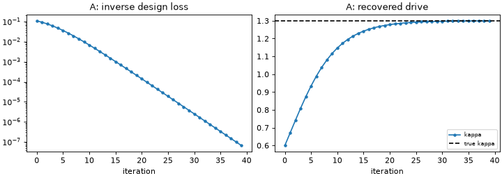

# 07 Differentiable workflows

**Goal:** use the fact that every DRBX model is written in JAX. Take an exact
gradient through a nonlinear turbulence run, use it to recover an input from
an output, and differentiate a steady state without differentiating the
solver iterations.

Script: [`examples/tutorial/07_differentiable.py`](../../examples/tutorial/07_differentiable.py)

## Part A: a gradient through a turbulence run

\(E(\kappa)\) is the fluctuation energy after 150 RK4 steps of the
Hasegawa-Wakatani model of step 02, as a function of the drive \(\kappa\):

$$
E(\kappa) = \sum_k \left(k^2 |\phi_k|^2 + |n_k|^2\right)\Big|_{t = 150\,\Delta t}.
$$

`jax.grad(final_energy)` differentiates through every step (reverse mode).
The script checks it against a central finite difference, then minimizes
\(L(\kappa) = (\ln E(\kappa) - \ln E_\text{target})^2\) by gradient descent,
starting from \(\kappa = 0.6\), to recover the \(\kappa = 1.3\) that produced
\(E_\text{target}\).

## Part B: the implicit-function theorem at a steady state

\(T_t(n_\text{up})\) is the steady target temperature of the SD1D-matched
leg of step 05. The steady state \(u^*\) solves \(F(u^*, p) = 0\), so

$$
\frac{du^*}{dp} = -\left(\frac{\partial F}{\partial u}\right)^{-1}\frac{\partial F}{\partial p}:
$$

one linear solve with the Jacobian at the converged state, independent of
how many Newton/pseudo-time iterations found it.
`detachment_target_outputs` implements this as a JAX custom derivative, so
`jax.jacfwd` gives \(dT_t/dn_\text{up}\). One Newton step on
\(\ln T_t(n_\text{up})\) then moves \(T_t\) toward a requested value.

| Piece | Code |
|---|---|
| HW run, differentiable end to end | `drbx.native.hasegawa_wakatani`: `hw_run`, `potential_from_vorticity` |
| steady leg, implicit derivative | `drbx.native.neutrals`: `detachment_sol_run`, `detachment_target_outputs` |

## Run

```bash
PYTHONPATH=src python examples/tutorial/07_differentiable.py
```

Python only (about 35 s).

## Output

```text
[07] A: dE/dkappa at kappa=1: autodiff 2.48800134e-03, finite difference 2.48800134e-03, rel. diff 5.0e-11 (2.1s)
[07] A: recovered kappa=1.2996 (true 1.3)
[07] B: steady state converged, residual 2.7e-11 (14.4s)
[07] B: T_t=18.746 eV, dT_t/dn_up implicit -2.135046e-18, finite difference -2.134974e-18 (rel. diff 3.4e-05)
[07] B: one Newton step n_up 2.000e+19 -> 2.552e+19: T_t 18.75 -> 11.15 eV (requested 10.0) (30.2s)
```



- **A:** the reverse-mode gradient through 150 nonlinear steps agrees with
  the finite difference to \(5\times10^{-11}\). Forty plain gradient-descent
  steps recover \(\kappa\) to \(4\times10^{-4}\) (left: loss; right:
  \(\kappa\) per iteration).
- **B:** the implicit derivative agrees with a finite difference of two full
  steady solves to \(3\times10^{-5}\) (the finite difference carries the
  solver tolerance). The target temperature is strongly nonlinear in
  \(n_\text{up}\), so one Newton step lands at 11.15 eV, not 10 eV; repeating
  it converges ([`examples/autodiff/detachment_control.py`](../../examples/autodiff/detachment_control.py)).

## Try next

- Set `LEARNING_RATE = 1.0`. Does gradient descent still converge?
- Change `TARGET_EV` to 5.0 and add a second Newton step.
- More: [Performance and Differentiability](../performance_and_differentiability.md),
  [Autodiff and Scaling Examples](../autodiff_and_scaling_examples.md).
