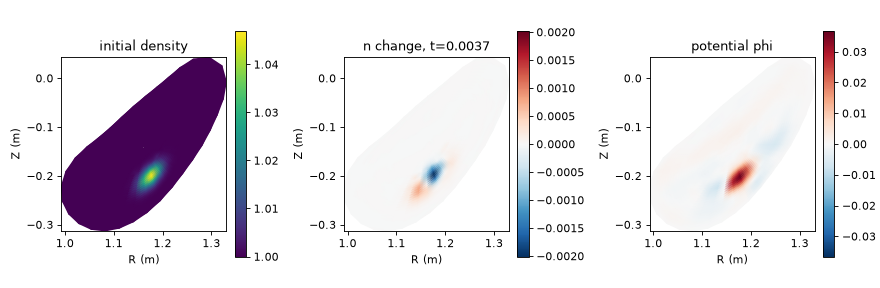

# 08 HSX: a drift-reduced Braginskii filament in a stellarator

**Goal:** run the production backend `drbx.fci_braginskii` on a real
stellarator. A density filament is seeded in HSX on a precomputed FCI
geometry (32 x 32 x 32 cells, field lines traced from the vacuum coils, the
vessel as the wall) and advanced with seven fields and an implicit
current/potential solve. This is the same run as `drbx run
examples/inputs/hsx_fci_blob.toml`.

Script: [`examples/tutorial/08_hsx_fci_braginskii.py`](../../examples/tutorial/08_hsx_fci_braginskii.py)

**You need the geometry bundle.** It is not in the repository; obtain
`hsx_fci_32x32x32` from the maintainers and place it at
`artifacts/geometry/hsx_fci_32x32x32` (ignored by git), or set the
`GEOMETRY` constant in the script. See
[HSX FCI Braginskii backend](../fci_braginskii_hsx_backend.md#geometry-artifact).

## Equations

The state is \(n, T_e, T_i, V_{\parallel i}, V_{\parallel e}, \omega\) and the
potential \(\phi\). Schematically (all operators on the FCI grid of step 06,
\(\rho_\star = \rho_s/L_\text{ref} = 5\times10^{-4}\), time in
\(L_\text{ref}/c_s \approx 21\,\mu\text{s}\)):

$$
\begin{aligned}
\partial_t n &= -\frac{\{\phi, n\}}{\rho_\star B} + \rho_\star\,\text{(curvature terms in } n, T_e, \phi)
  - \nabla_\parallel(n V_{\parallel e}) + D_\perp \nabla_\perp^2 n,\\
\partial_t \omega &= -\frac{\{\phi, \omega\}}{\rho_\star B} + \nabla_\parallel J_\parallel
  + \rho_\star\,C(p_e + p_i),\qquad J_\parallel = n(V_{\parallel i} - V_{\parallel e}),\\
\nabla_\perp\!\cdot\!\left(\frac{\rho_\star^2\, n}{B^2}\nabla_\perp\phi\right) &= \omega
\quad\text{(polarization; solved with FGMRES)},
\end{aligned}
$$

with analogous equations for \(T_e, T_i\) (parallel conduction) and for the
parallel velocities (the electron equation carries
\(\mu \nabla_\parallel \phi\) with \(\mu = m_i/m_e = 1836\) plus collisional
friction). The full term list is in
[the backend page](../fci_braginskii_hsx_backend.md#fixed-configuration).

Time stepping is IMEX-SSP222. In each implicit stage
\(\mu\nabla_\parallel\phi\) and \(\nabla_\parallel J_\parallel\) are solved
together with \(\phi\) (the *implicit current/potential pair*), which removes
the explicit limit \(\Delta t \approx 10^{-4}\) set by the electron parallel
dynamics; the deck uses \(\Delta t = 7.5\times10^{-4}\). Walls are no-flow
(\(V_\parallel = 0\)) with Dirichlet \(\phi, \omega\); there is no sheath or
neutral model in this backend.

| Piece | Code |
|---|---|
| deck reader, run driver, initial filament | `drbx.fci_braginskii.run`: `load_hsx_blob_deck`, `run`, `build_initial_state` |
| geometry bundle reader (FCI maps, RLP topology) | `drbx.fci_braginskii.geometry.fci_simulation_geometry` |
| E x B brackets, curvature, parallel fluxes, right-hand side | `drbx.fci_braginskii.native.fci_drb_EB_rhs`, `fci_parallel_production_flux`, `fci_curvature_production_flux` |
| wall boundary traces | `drbx.fci_braginskii.native.fci_boundaries` |
| potential / current-potential solves (SOLVAX FGMRES) | `drbx.fci_braginskii.native.fci_gmres.solvax_gmres_solve` |

## Run

```bash
PYTHONPATH=src python examples/tutorial/08_hsx_fci_braginskii.py
```

or, equivalently, `drbx run examples/inputs/hsx_fci_blob.toml` with the
deck's `geometry` pointing at the bundle. About 160 s on a laptop CPU (four
threads): roughly 75 s of one-time compilation, then about 13 s per step.

## Output

```text
[08] deck examples/inputs/hsx_fci_blob.toml: 5 steps to t=0.00375, rho*=0.0005, implicit current/phi pair=True
...
[####--------------------]     1/5 t=7.500000e-04 step=11.34s op=6.04s gmres=5.22s gmres-iters(avg4)=76.50 ...
...
[########################]     5/5 t=3.750000e-03 step=12.97s op=6.51s gmres=6.46s gmres-iters(avg4)=96.25 ...
[simulation] average imex-ssp222 GMRES iterations: 91.55 (four solves per timestep)
[08] run finished in 157s
[08] times saved: [0.0, 0.00375]
[08] density: initial peak 1.04684, final peak 1.04483 (the filament starts to move and relax along the field)
[08] potential: max |phi| 4.035e-02 (from the vorticity / polarization balance)
```



The toroidal plane through the filament peak, in \((R, Z)\): the initial
density (left), its change after five steps (centre) and the potential
(right). The potential peaks on the filament, with weaker opposite-sign
lobes around it; its \(E\times B\) flow and the curvature drift start to
move and reshape the density (the red/blue pair in the centre panel), and
the peak drops from 1.0468 to 1.0448.
Each step does four GMRES solves of about 90 iterations each; they take about
half the step.

## Try next

- Set `NUM_STEPS = 200` and `FINAL_TIME = 0.15` (the documented run, about
  45 minutes on a laptop) and watch the filament propagate.
- Halve the step (`NUM_STEPS = 10`) and compare the potential: it is the
  least accurate field in time (see the temporal-order table on the backend
  page).
- More: [HSX FCI Braginskii backend](../fci_braginskii_hsx_backend.md),
  [Stellarator FCI turbulence](../tutorial_stellarator_fci.md).
